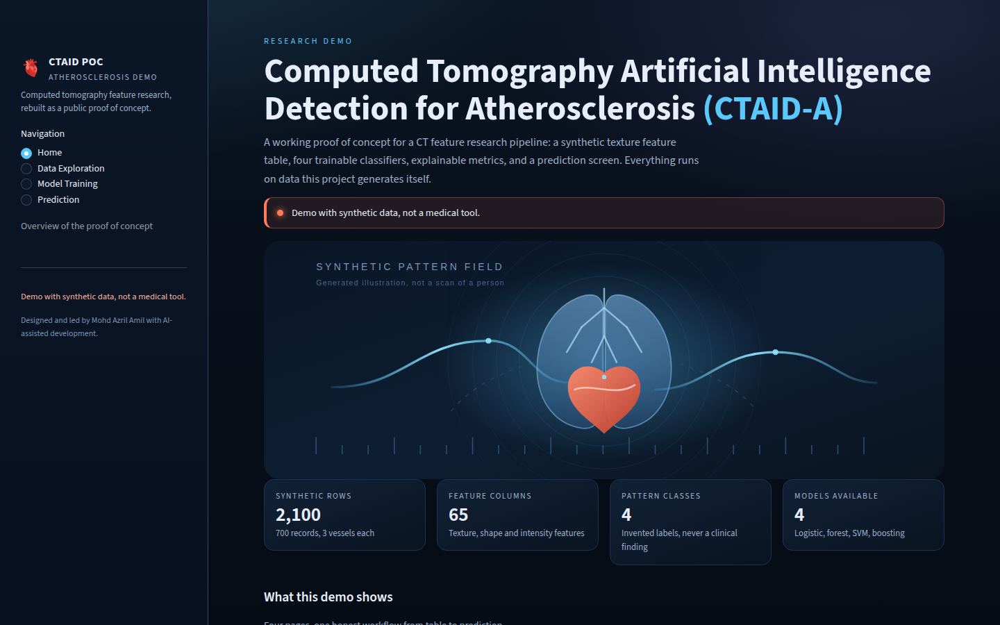
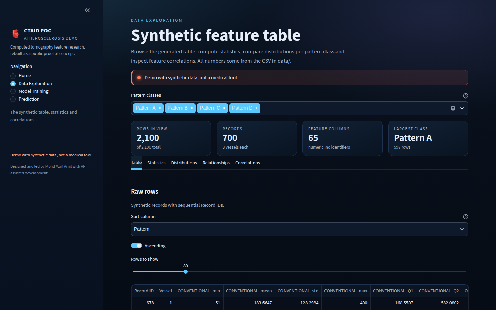
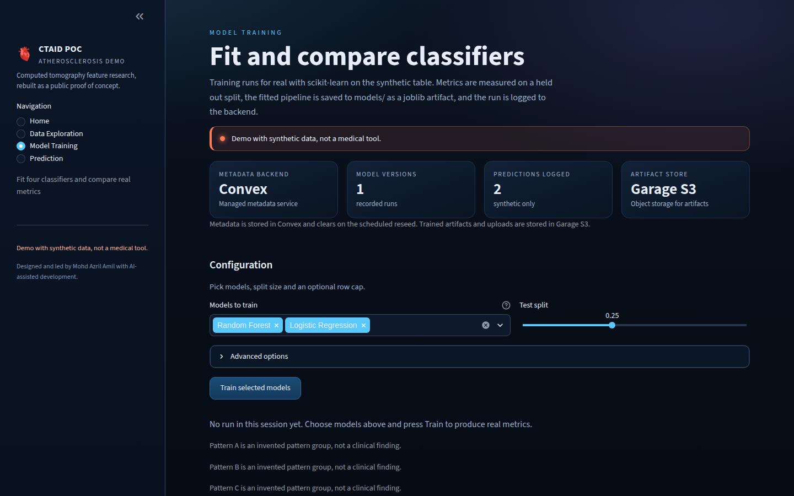
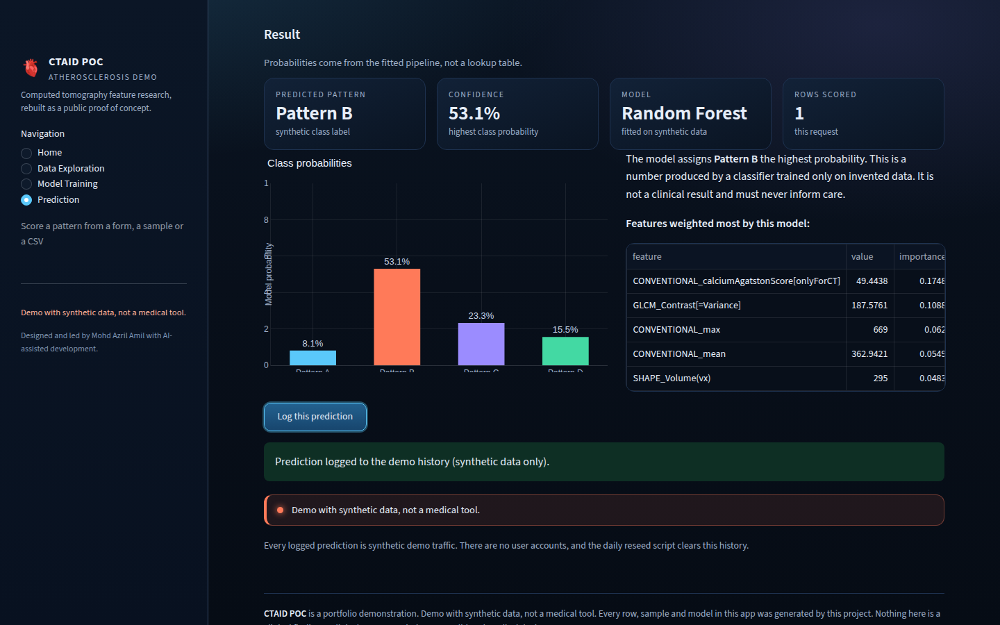

# CTAID POC

[](https://github.com/azrilamil/ctaid-poc/actions/workflows/ci.yml)
[](LICENSE)

A faithful, working rebuild of a computed tomography atherosclerosis detection
research interface, as a public portfolio proof of concept. Python and
Streamlit, a synthetic texture feature table, four real trainable classifiers,
and a prediction screen. Built from scratch: it contains no private research
data, no clinical images, and no copied code from the original system.

**Live demo:** [https://ctaid-poc.azril.io](https://ctaid-poc.azril.io)

> **Demo with synthetic data, not a medical tool.** This app uses invented local data only. It is not a medical device, it does not provide clinical findings, and it is not affiliated with any clinic, university, or other institution. It must not be used for clinical decisions.

## What it is

CTAID-A expands to Computed Tomography Artificial Intelligence Detection for
Atherosclerosis. This repository rebuilds the shape of that research tool as a
public demo:

- a **Home** page with an original hero illustration, project summary and
  privacy note
- **Data Exploration** over a 2100 row synthetic feature table: filtering,
  descriptive statistics, per class distributions, scatter plots, correlation
  heatmap
- **Model Training** where four classifiers really fit: Logistic Regression,
  Random Forest, SVM and Gradient Boosting, compared on accuracy, macro
  precision, macro recall, macro F1 and macro ROC AUC, with a classification
  report, confusion matrix, one versus rest ROC curves and feature importance
- **Prediction** from a slider form, a generated sample pattern, or a small
  uploaded CSV, returning class probabilities

Four pattern classes (`Pattern A` to `Pattern D`) are invented labels for the
demo. They are never presented as clinical categories.

## Screenshots

| Home | Data Exploration |
| --- | --- |
|  |  |

| Model Training | Prediction |
| --- | --- |
|  |  |

Captured from the live demo at [https://ctaid-poc.azril.io](https://ctaid-poc.azril.io)
on 13 Nov 2026 (Asia/Kuala_Lumpur), 1440 by 900. The demo notice is visible in every
shot. See `docs/screenshots/README.md` for the capture rules.

## Run locally

```bash
python3 -m venv .venv
source .venv/bin/activate
pip install -r requirements.txt
python scripts/generate_synthetic_data.py     # writes data/synthetic_features.csv
python scripts/train_demo_model.py            # writes models/*.joblib
streamlit run streamlit_app.py
```

Open [http://localhost:8501](http://localhost:8501).

Run the gates:

```bash
pytest -q
python scripts/scan_content.py
```

## Docker

```bash
docker build -t ctaid-poc .
docker run --rm -p 8080:80 ctaid-poc
curl -fsS http://127.0.0.1:8080/health
```

Then open [http://localhost:8080](http://localhost:8080). Inside the image nginx
listens on port 80, answers `/health` itself and proxies the app to Streamlit on
8080, including the websocket stream, so the existing Coolify app layout keeps
working.

## The data

`data/synthetic_features.csv` is generated by
`scripts/generate_synthetic_data.py`:

| Item | Value |
| --- | --- |
| Rows | 2100 (700 records, 3 vessels each) |
| Columns | 68, of which 65 are numeric features |
| Identifier | `Record ID`, sequential, no person behind it |
| Target | `Pattern`, values 0 to 3, labels `Pattern A` to `Pattern D` (the CSV column is still named `Diagnosis` internally; the UI always shows `Pattern`) |
| Seed | 20261113, fixed for reproducibility |

Column names, dtypes and value ranges come from a design brief. No rows were
copied, sampled or interpolated from a real table. See
[docs/data-generation.md](docs/data-generation.md) for the sampling model and
[docs/data-and-privacy.md](docs/data-and-privacy.md) for what is and is not in
the repository.

## Optional backend wiring

Both integrations are real but optional; the app is complete without them.
The live demo at [https://ctaid-poc.azril.io](https://ctaid-poc.azril.io) is
wired to both.

| Feature | Live demo | With env vars | Without env vars |
| --- | --- | --- | --- |
| Dataset metadata, model versions, prediction history | Convex at [https://convex-demo.azril.io](https://convex-demo.azril.io), a dedicated deployment separate from any private app | Convex (`CONVEX_URL`) | SQLite in `var/ctaid-demo.sqlite3` |
| CSV uploads and model artifacts | Garage S3 bucket `ctaid-poc-demo` | Garage S3 (`S3_ENDPOINT`, `S3_BUCKET`, `S3_ACCESS_KEY_ID`, `S3_SECRET_ACCESS_KEY`) | `var/objects/` on local disk |

The Model Training page shows a Convex badge for metadata and a Garage S3 badge
for artifacts, with a caption that names both. A Convex cron at 03:20 UTC clears
prediction history and model-version rows. The Python reseed script can do a
fuller reset, including local files.

Secrets are read from the environment only and are never committed.
`.env.example` lists the variable names with empty values. Each stored record and
object reports which backend served it, so you can see whether the cloud path
actually ran.

Reset the demo, for example on a daily cron:

```bash
python scripts/reseed-demo.py --dry-run   # what would change
python scripts/reseed-demo.py             # regenerate CSV, clear uploads and history
```

```
15 3 * * *  cd /srv/ctaid-poc && python scripts/reseed-demo.py >> var/reseed.log 2>&1
```

## Privacy

- No real records, no DICOM, no third party photographs, no institution names.
- The hero image is an original SVG generated by `app/artwork.py` under the MIT
  license, documented in [docs/assets.md](docs/assets.md).
- Uploads are limited to CSV, 2 MB, 500 rows, text content type, and are cleared
  by the reseed script.
- `scripts/scan_content.py` scans the work tree for forbidden markers, personal
  data patterns, credentials, identifier headers and forbidden dashes. CI runs
  it on every push.

## Stack

- Python 3.12, Streamlit 1.67
- pandas, NumPy, scikit-learn, Plotly, joblib
- boto3 and requests for the optional Garage S3 and Convex paths
- Pytest, including `streamlit.testing.v1` page smoke tests
- nginx in front of Streamlit, GitHub Actions CI

## Documentation

| Document | Content |
| --- | --- |
| [docs/architecture.md](docs/architecture.md) | mermaid diagrams, modules, degradation and reset flow |
| [docs/features.md](docs/features.md) | page by page feature list |
| [docs/data-generation.md](docs/data-generation.md) | generator design, seed, reproducibility |
| [docs/data-and-privacy.md](docs/data-and-privacy.md) | what is in the repo, upload rules, scan |
| [docs/model-card.md](docs/model-card.md) | models, measured metrics, limitations |
| [docs/testing-and-ci.md](docs/testing-and-ci.md) | test layout, gates, CI steps |
| [docs/design-decisions.md](docs/design-decisions.md) | why Streamlit, why generated data, fallbacks |
| [docs/assets.md](docs/assets.md) | hero and icon provenance and license |

## My role

Designed and led by **Mohd Azril Amil** with AI-assisted development. I set the
product scope, the synthetic data design, the privacy rules and the acceptance
criteria, built and reviewed the implementation, and ran the gates.

## What this is not

A portfolio demonstration. It does not contain clinical images, private research
tables, real personal records, personal data, or deployment secrets. It makes no
clinical claim and must not be used for care.

## License

MIT. See [LICENSE](LICENSE).
