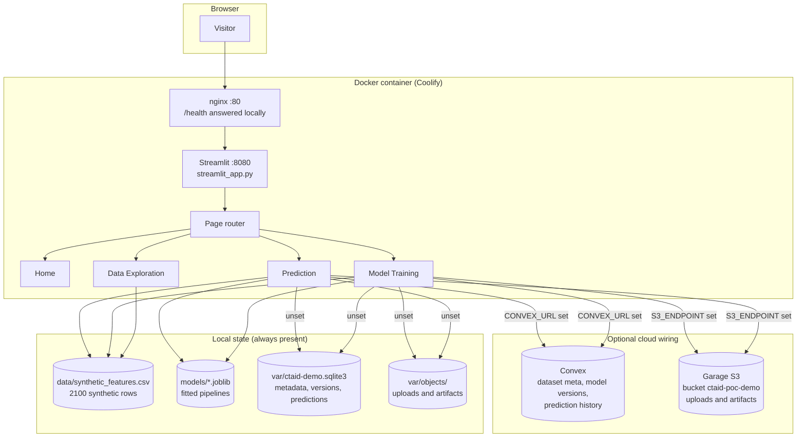
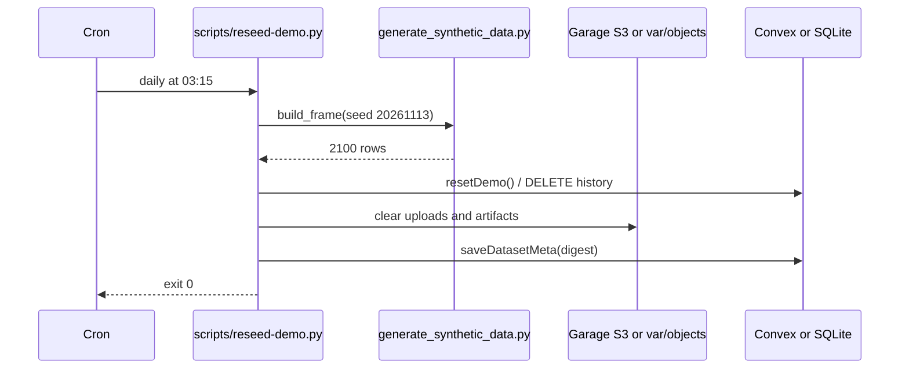

# Architecture

CTAID POC is a Streamlit application with an optional cloud backplane. It is a
single process, single page router, with no user accounts. Every dependency
below has a local fallback, so the app runs completely offline.

## Request path

1. nginx answers `/health` and `/healthz` without touching Python, which keeps
   the Coolify health check fast and independent of Streamlit start up.
2. Everything else is proxied to Streamlit with the websocket upgrade headers
   on `/_stcore/stream`.
3. `streamlit_app.py` applies the theme, registers dataset metadata once per
   process, renders the sidebar and dispatches to one page module.
4. Each page module reads the synthetic CSV through `app/state.py`, which caches
   the frame on path plus modification time.

## Modules

| Module | Responsibility |
| --- | --- |
| `streamlit_app.py` | Entry point, theme, sidebar router |
| `app/theme.py` | Palette, CSS, cards, notices, page headers |
| `app/schema.py` | Column names, dtypes and sampling ranges |
| `app/data.py` | Load, summarise, correlate, sample the CSV |
| `app/training.py` | Model registry, pipelines, metrics, artifacts |
| `app/predict.py` | Upload validation, feature alignment, scoring |
| `app/charts.py` | Plotly figures on the project palette |
| `app/backend.py` | Convex HTTP client with a SQLite fallback |
| `app/storage.py` | Garage S3 client with a local filesystem fallback |
| `app/artwork.py` | Generates the original hero SVG |
| `app/privacy.py` | Privacy and content scan helpers |
| `app/bootstrap.py` | Registers dataset metadata at start up |

## Degradation rules

- `CONVEX_URL` unset or unreachable: SQLite in `var/` serves the same calls, and
  each row is tagged with the backend that answered.
- `S3_ENDPOINT` unset or unreachable: uploads and artifacts go to `var/objects`.
- Dataset missing: `app/data.py` regenerates it from the fixed seed.
- Model artifact missing: the Prediction page asks the visitor to train first
  rather than inventing a score.

## Reset flow

